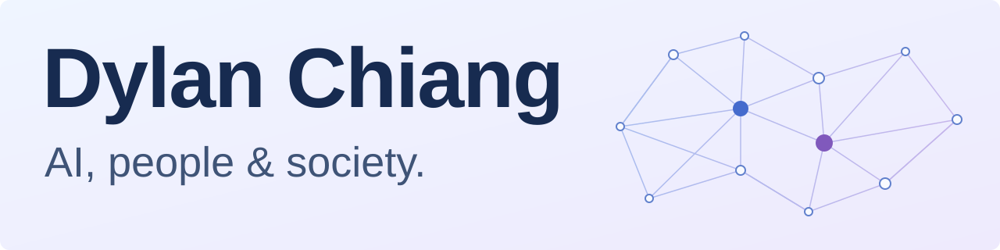

<picture>
  <source media="(prefers-color-scheme: dark)" srcset="assets/profile-banner-dark.svg">
  <source media="(prefers-color-scheme: light)" srcset="assets/profile-banner-light.svg">
  
</picture>

## 蔣濤 Dylan Chiang

理解人的行為，打造有用的 AI。

- **博士生** · 復旦大學大數據學院智能科學與技術／[Fudan DISC](http://www.fudan-disc.com/)

關注 **自然語言處理與大型語言模型、計算社會科學、以人為本的人工智慧**。我把社會科學的問題意識帶進 AI 研究，也為研究與知識工作開發實用工具。

## 精選作品

- [**博雅 BOYA**](https://github.com/boya-research/BOYA-skills)：人文社科 AI 研究技能庫，讓研究者保有關鍵判斷。 
  我負責工作流設計、技能開發與開源維護。

- [**LegalWorld**](https://github.com/sii-research/Legal-world)：法律智能體生命週期互動環境。 
  合作研究／共同作者（第三作者）；主要負責前端與互動體驗，並參與研究支援。

- [**WeMark**](https://github.com/dylanchiang-projects/DC-WeMark)：在瀏覽器裡，把 Markdown 排版成微信公眾號文章。 
  個人工具作品。

## 找到我

[學術網站](https://dylanchiang-dev.github.io/) · [個人主頁](https://www.3331322.xyz/) · [Email](mailto:3331322@gmail.com)
